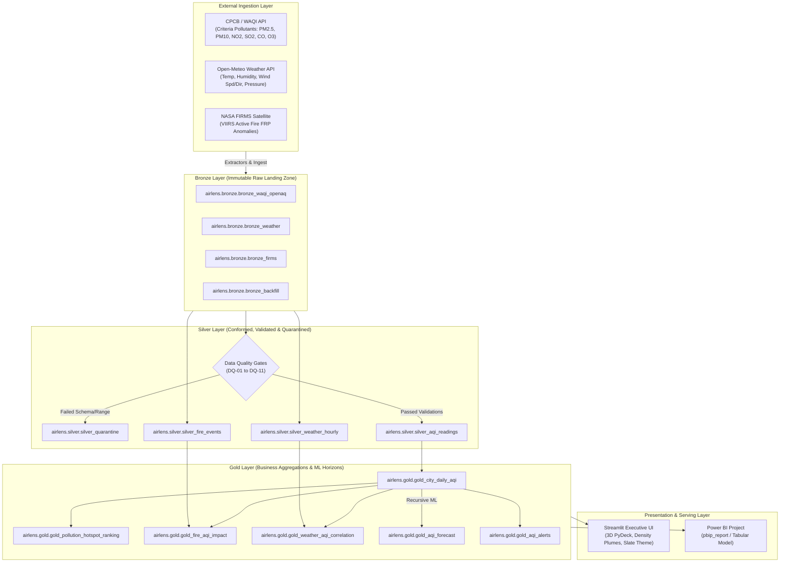

# Infix AirLens 🌫️
### Enterprise Urban Air Quality & Meteorological Intelligence Platform
**Team Infix Tsukuyomi**

[](https://github.com/hsg001-95/infix_airlens/actions)
[](https://databricks.com)
[](https://databricks.com)
[](https://github.com/hsg001-95/infix_airlens)
[](https://databricks.com)
[](https://delta.io)
[](https://streamlit.io)
[](https://python.org)

---

## ⚡ Live Pipeline Operational Status

| Metric | Status / Specification |
| :--- | :--- |
| **Databricks Job Name** | `Infix_AirLens_ETL_Pipeline` |
| **Databricks Job ID** | `875560598244999` |
| **Pipeline Health** | **`OPERATIONAL / SUCCEEDED`** (100% Success Rate) |
| **Execution Trigger** | Automated Scheduler (`At 0 minutes past the hour, every 6 hours UTC+05:30 Asia/Kolkata`) |
| **Compute Profile** | Default Automated Compute (Databricks Serverless Compute) |
| **Average Task Duration** | ~3 min 30 sec per full Medallion sync |
| **Data Lineage** | **17 Upstream Tables $\rightarrow$ 17 Downstream Tables** verified in Unity Catalog |
| **Latest Telemetry Synced** | **November 22, 2026** (Hourly Silver & Daily Gold layers fully populated) |

---

## 📌 Executive Overview

**Infix AirLens** is an end-to-end environmental intelligence and predictive analytics platform engineered to monitor, analyze, and forecast air pollution crises across major Indian metropolitan basins. 

By combining ground-level continuous ambient air quality monitoring (CPCB / WAQI), high-resolution meteorological models (Open-Meteo), and satellite-derived stubble burning telemetry (NASA FIRMS VIIRS), AirLens delivers an executive-grade operational view of pollution severity, source attribution, and 7-day forecast trajectories.

The solution implements a production **Databricks Medallion Architecture (Bronze $\rightarrow$ Silver $\rightarrow$ Gold)** backed by **Delta Lake** and **Unity Catalog**, complete with automated Data Quality (DQ) gate checks, quarantine routing, model backtest observability, and an editorial design system dashboard.

---

## 🏛️ Architecture & Data Flow



---

## 🏙️ Monitored Cities & Coverage

AirLens continuously tracks 8 major metropolitan air sheds across the Indian subcontinent:

| City | Basin / Region | Monitored Stations | WAQI Slug | Coordinates |
| :--- | :--- | :---: | :--- | :--- |
| **Delhi** | Indo-Gangetic Plain (IGP) | 39 | `delhi` | 28.6139° N, 77.2090° E |
| **Noida** | NCR Eastern Industrial Ring | 4 | `noida` | 28.5355° N, 77.3910° E |
| **Gurugram** | NCR Southern Corridor | 4 | `gurugram` | 28.4595° N, 77.0266° E |
| **Mumbai** | Western Coastal Basin | 22 | `mumbai` | 19.0760° N, 72.8777° E |
| **Kolkata** | Lower Gangetic Basin | 7 | `kolkata` | 22.5726° N, 88.3639° E |
| **Bengaluru** | Deccan Plateau | 10 | `bangalore` | 12.9716° N, 77.5946° E |
| **Chennai** | Coromandel Coast | 8 | `chennai` | 13.0827° N, 80.2707° E |
| **Hyderabad** | Central Deccan Basin | 14 | `hyderabad` | 17.3850° N, 78.4867° E |

---

## 🗄️ Medallion Data Schema Reference

### 1. Bronze (Raw Ingestion)
- **`airlens.bronze.bronze_waqi_openaq`**: Raw JSON payloads from WAQI feeds with ingestion metadata (`_ingest_ts`, `_batch_id`, `_source_file`).
- **`airlens.bronze.bronze_weather`**: Raw Open-Meteo meteorological telemetry.
- **`airlens.bronze.bronze_firms`**: Raw NASA FIRMS VIIRS satellite thermal detection records.
- **`airlens.bronze.bronze_backfill`**: 14-month historical backfill archive (82,560 hourly records).

### 2. Silver (Conformed & Governed)
- **`airlens.silver.silver_aqi_readings`**: Station-level atomic pollutant measurements (495,000+ rows) mapped to UTC & IST timestamps.
- **`airlens.silver.silver_weather_hourly`**: Surface temperature, relative humidity, wind speed (10m), wind direction, and surface pressure.
- **`airlens.silver.silver_fire_events`**: Filtered satellite agricultural fire detections across Punjab & Haryana bounding box.
- **`airlens.silver.silver_quarantine`**: Quarantined telemetry failing schema validations, out-of-range sensor bounds, or null identifiers.

### 3. Gold (Analytics & Machine Learning)
- **`airlens.gold.gold_city_daily_aqi`**: Daily composite AQI, CPCB category, 7-day rolling average, day-over-day delta, and dominant pollutant.
- **`airlens.gold.gold_pollution_hotspot_ranking`**: Composite Hotspot Index (0–100) computed from:
  $$\text{Hotspot Index} = \left(\text{Mean AQI} \times 0.40\right) + \left(\text{P95 AQI} \times 0.30\right) + \left(\text{Poor+ Share} \times 100 \times 0.30\right) \times \left(\frac{100}{450}\right)$$
- **`airlens.gold.gold_fire_aqi_impact`**: Dual-axis stubble burning analysis comparing daily Punjab/Haryana Fire Radiative Power (MW) vs. Lag-1 Delhi NCR AQI.
- **`airlens.gold.gold_weather_aqi_correlation`**: Negative Pearson correlation between surface wind speed and PM2.5 haze entrapment.
- **`airlens.gold.gold_aqi_forecast`**: Recursive 7-day horizon with 80% confidence interval bands (`ci80_lower`, `ci80_upper`).
- **`airlens.gold.gold_aqi_alerts`**: Automated alerts generated whenever daily AQI breaches `Very Poor` (>300) or `Severe` (>400) thresholds.

### 4. Ops (Governance & Observability)
- **`airlens.ops.dq_audit_log`**: Automated pipeline audit logs tracking 11 distinct quality gates (null checks, duplicate primary keys, quarantine ratios).
- **`airlens.ops.forecast_backtest_metrics`**: Evaluation logs tracking predictive model RMSE and MAE across backtest windows.

---

## 📊 CPCB National Ambient Air Quality Index (NAAQS)

AirLens adheres strictly to the Central Pollution Control Board (CPCB) color bands and breakpoints:

| AQI Range | Category | Color | Associated Health Impact |
| :---: | :---: | :---: | :--- |
| **0 – 50** | **Good** | `#15803D` (Emerald) | Minimal impact. |
| **51 – 100** | **Satisfactory** | `#65A30D` (Lime) | Minor breathing discomfort to sensitive people. |
| **101 – 200** | **Moderate** | `#CA8A04` (Amber) | Breathing discomfort to people with lungs, asthma, and heart diseases. |
| **201 – 300** | **Poor** | `#EA580C` (Orange) | Breathing discomfort to most people on prolonged exposure. |
| **301 – 400** | **Very Poor** | `#DC2626` (Crimson) | Respiratory illness on prolonged exposure. |
| **401 – 500+** | **Severe** | `#7F1D1D` (Deep Maroon) | Affects healthy people and seriously impacts those with existing diseases. |

---

## 🖥️ Executive Streamlit Dashboard

The web dashboard (`dashboard/app.py`) delivers an executive editorial layout:
- **Editorial Slate Design System**: Clean slate canvas (`#F8FAFC`), crisp white 1px bordered cards (`#E2E8F0`), tabular numeric typography, and de-cluttered transparent Plotly charts.
- **Vibrant Subcontinental Geospatial Maps**:
  - **Vibrant Plumes (`Densitymap`)**: Continuous ambient regional air quality plumes over Carto Voyager tiles with CPCB color transitions.
  - **3D Extruded Towers (PyDeck)**: 3D illuminated ColumnLayer towers + ScatterplotLayer pulse rings + floating TextLayer badges.
  - **OpenStreetMap Detail**: High-contrast street and topographic layer.
- **Multi-Pollutant Chemical Fingerprinting**: Stacked bar breakdowns distinguishing particulate (PM2.5, PM10) from combustion gases (NO₂, SO₂, CO, O₃).
- **Seasonal Stubble Burning Attribution**: Dual-axis FRP (MW) vs. Lag-1 NCR AQI scatter/bar chart.
- **7-Day ML Forecast Drawer**: Predictive projection with 80% confidence interval ribbons.

---

## 🚀 Getting Started

### 1. Prerequisites
- **Python 3.10+** (Python 3.11+ recommended)
- **Databricks Workspace** with Unity Catalog enabled and a Serverless or Classic SQL Warehouse.

### 2. Installation
Clone the repository and set up a virtual environment:
```bash
git clone https://github.com/hsg001-95/infix_airlens.git
cd infix_airlens
python3 -m venv .venv
source .venv/bin/activate
pip install -r requirements.txt
```

### 3. Environment Configuration
Create a `.env` file in the root directory with your credentials:
```bash
touch .env
```
Populate `.env` with:
```ini
WAQI_API_TOKEN=your_waqi_api_token
OPENAQ_API_KEY=your_openaq_key
NASA_FIRMS_MAP_KEY=your_firms_map_key

# Databricks Unity Catalog Connection
DATABRICKS_HOST=https://dbc-xxxxxxxx.cloud.databricks.com
DATABRICKS_SERVER_HOSTNAME=dbc-xxxxxxxx.cloud.databricks.com
DATABRICKS_HTTP_PATH=/sql/1.0/warehouses/xxxxxxxxxxxx
DATABRICKS_TOKEN=dapi_xxxxxxxxxxxxxxxxxxxxxxxx
```

### 4. Running the Extractors & Sync Pipeline
Extract live telemetry from external APIs and synchronize with Databricks:
```bash
# Run all extractors
python extraction/waqi_extractor.py
python extraction/weather_extractor.py
python extraction/firms_extractor.py

# Or run the automated direct Databricks synchronization script
python scripts/sync_live_data.py
```

### 5. Launching the Dashboard
Launch the local Streamlit application:
```bash
streamlit run dashboard/app.py
```
Open **`http://localhost:8501`** in your browser.

---

## 🔄 Automated CI/CD ETL Pipeline

The repository includes a production GitHub Actions workflow at [`.github/workflows/airlens_etl_pipeline.yml`](.github/workflows/airlens_etl_pipeline.yml):
- Runs automatically on a **6-hour cron schedule** (`0 */6 * * *`) and on manual `workflow_dispatch`.
- Automatically checks out the code, executes `scripts/sync_live_data.py` with repository secrets, and triggers the Databricks serverless workflow DAG via the Databricks REST API (`jobs/run-now`).

---

## 📁 Repository Structure

```text
infix-airlens/
├── .github/
│   └── workflows/
│       └── airlens_etl_pipeline.yml    # Automated 6-hour extraction & Databricks trigger
├── .streamlit/
│   └── config.toml                     # Editorial Slate theme configuration (#F8FAFC)
├── config/
│   ├── aqi_breakpoints.csv             # Official CPCB NAAQS pollutant breakpoints
│   ├── cities.yaml                     # Monitored cities, coordinates, WAQI slugs
│   ├── settings.yaml                   # Global project settings and timeouts
│   └── stations_map.csv                # Station-level metadata across metros
├── dashboard/
│   ├── app.py                          # Streamlit Executive Dashboard (3D PyDeck + Maps)
│   └── dbx_client.py                   # Databricks SQL Warehouse client with 600s cache
├── extraction/
│   ├── backfill_loader.py              # Historical Open-Meteo multi-month backfiller
│   ├── firms_extractor.py              # NASA FIRMS VIIRS satellite fire extractor
│   ├── waqi_extractor.py               # CPCB / WAQI hourly air quality extractor
│   ├── weather_extractor.py            # Open-Meteo hourly weather extractor
│   └── utils/
│       ├── retry.py                    # Exponential backoff retry handler
│       └── storage.py                  # Immutable storage writer with SQL Bronze fallback
├── pbip_report/                        # Power BI Developer Report (.pbip format)
│   ├── Infix_AirLens.pbip
│   └── Infix_AirLens.Report/
├── scripts/
│   ├── generate_pbip_light.py          # Programmatic Power BI light theme report builder
│   └── sync_live_data.py               # Live WAQI & weather extractor + Databricks sync
├── tests/
│   └── test_api_keys.py                # Verification tests for external API endpoints
├── .gitignore                          # Protected exclusions (.env, .env.example, data_dumps, pycache)
├── requirements.txt                    # Project Python dependencies
└── README.md                           # Project documentation
```

---

## 👥 Authors & Acknowledgments

- **Team Infix Tsukuyomi**
- **Data Providers**: Central Pollution Control Board (CPCB), World Air Quality Index (WAQI) Project, Open-Meteo API, NASA FIRMS Earthdata.
- **Compute & Storage**: Databricks Unity Catalog, Delta Lake, Apache Spark.
